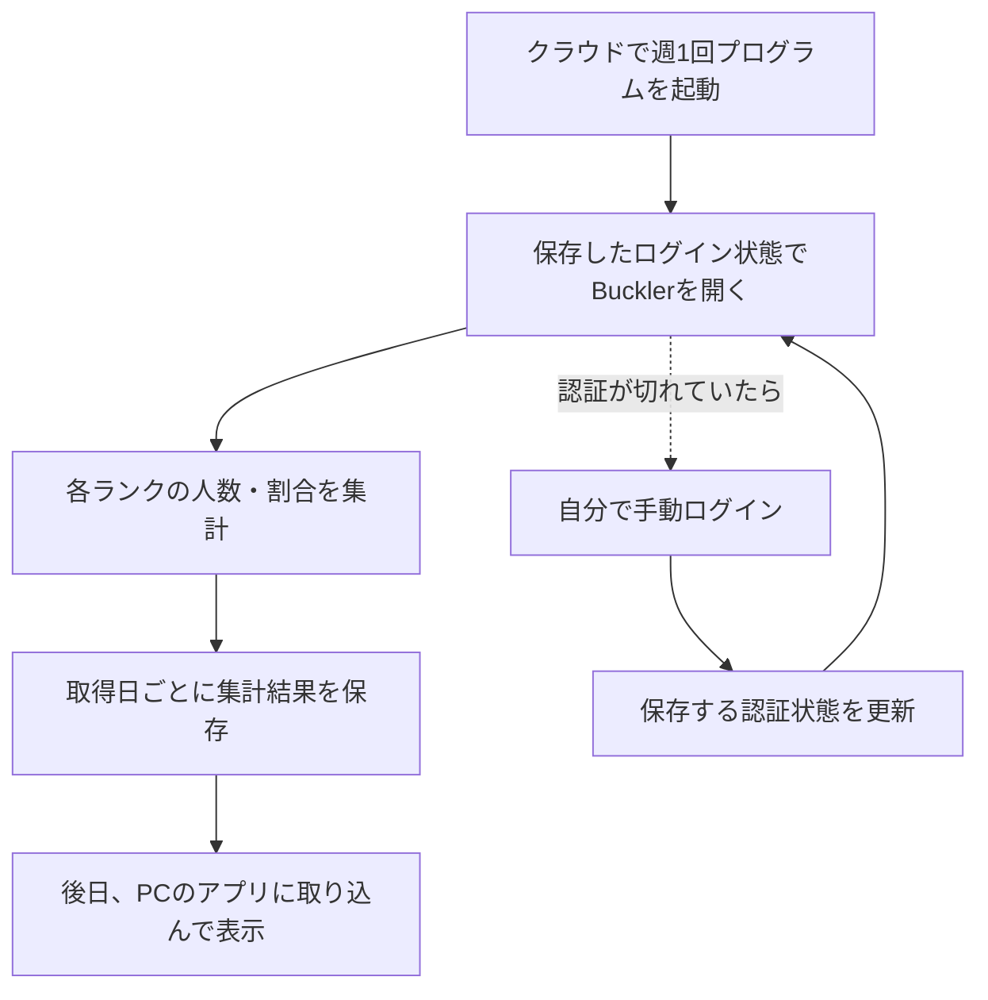

# ランク分布の週次取得フロー

更新日: 2026年10月15日

目標は、自分のPCがオフでも週1回Bucklerのランク分布を取得・保存し、あとでローカルアプリに取り込んで過去の分布を見られるようにすること。アプリは引き続きローカル利用を想定する。

このPCで認証状態を暗号化保存し、ツールとEdgeを終了した後の別起動で再利用できた。さらに2026年10月15日には、GitHubのWindows環境で保存済み認証を使い、手動ログインなしにランキング先頭20件を取得できた。全体取得・検証・保存・取り込みも接続し、取得中の人数の変動は概数として記録する方針を採用した。ローカルでは最大23／35境界まで実取得したが、ログイン要求で停止している。最新の再試行も約10分で停止し、全境界を含む実データと週次実行はまだ完成していない。

## 完成後に目指す流れ

初回は手動でログインし、次回以降に使う認証状態を安全に保存する。通常の取得は自動で行い、認証の期限切れ時には手動で更新する運用を目指す。一時的なGitHub Secretでの受け渡しは単発検証できたため、今後は週次運用での保管期間・認証の有効期間・更新方法を確かめる。

取得時は自分のPCの起動を不要にする。保存された結果をローカルアプリで閲覧するときは、PCとアプリを起動する。

## 現在の進捗

| 工程 | 2026年10月15日時点の状態 |
| --- | --- |
| このPCで認証を保存して再利用 | 確認済み。暗号化保存後にツールとEdgeを終了し、別プロセス・新しいEdgeコンテキストで手動ログインなしに先頭20件を取得できた |
| 1週間後も認証を再利用 | 未検証。今回確認したのは同日内の再利用 |
| クラウドで認証を再利用 | 10月15日の単発検証で確認済み。ユーザーの許可後に一時Secretへ送信した認証状態を使い、GitHubのWindowsとEdgeで手動ログインなしに先頭20件を取得できた。検証後にSecretは削除済み |
| 全ランク分布を実取得 | 概数方式を実装。17:31〜18:01 JSTの実行で23／35境界を確認し、総数変化では停止しなかったがログイン要求で停止。元の認証は新しいEdgeで再利用でき、20分ごとの開き直しを追加。最新18:10〜18:20 JSTの再試行は7／35境界、開き直し前にログイン要求で停止。全体取得と開き直しの有効性は未実証 |
| 日付付きデータの取り込みと表示 | 完全な検証済み集計だけを日時付き保存し、既存アプリへ取り込む処理を接続済み。実取得の停止理由もアプリに反映。完全集計の実データは未登録で、クラウドからの取得・取り込みの連携は未実装 |
| 週1回の自動実行 | 未設定。実行環境と取得方法を検証してから組み込む |

認証再利用の実操作・判定・保存方法は[認証と閲覧の検証記録](auth-probe.md)を参照。
クラウドの実行方法、認証なしのHTTP 403と認証付きの取得成功、Secretの削除確認は[クラウド取得検証](cloud-probe.md)を参照。
ローカルの全体取得コマンドと停止結果は[取得とアプリへの取り込み](collection.md)を参照。

## 保存するデータと失敗時の扱い

履歴として保存するのは取得日時、取得条件、ランク別のアカウント件数、出典、検証結果。ユーザーが選択した概数方式では、全35境界の位置・確認時刻・観測総数、取得期間全体の開始・終了・最小最大総数も保存する。割合は終了時総数を分母に表示時に計算し、同一時点の人口や総数差に基づく誤差上限とは扱わない。

対象は総合・最大LP・全地域・全プラットフォームの固定条件で掲載されたランキングで、集計単位はファイターアカウントとする。`user_status=1`は固定条件として記録し、全ユーザーという意味は未確認として扱う。

認証情報は集計結果と分けて管理する。元のDPAPI保存と専用ブラウザープロファイルはこのPC内に保持する。10月15日のクラウド検証では、ユーザーの許可を受けてStreet Fighterサイト用の認証状態だけを一時Secretへ送信し、検証後に削除を確認した。DPAPIファイル自体や専用プロファイル全体はクラウドへ送っていない。

取得に失敗した週は前回の正常データを保持し、失敗を記録する。未取得や一部だけの取得を、全ランク0件や完全集計として保存しない。取得条件と検証の詳細は[ランク分布の取得仕様](README.md)に従う。

## 次に進める作業

1. 取得期間中の概数として全35境界を確認し、20分ごとの取得用Edgeの開き直しを含む1回の全体取得・保存・取り込みを実証する。
2. 認証の有効期間、週次運用での保管方法、期限切れ時の更新方法を確かめる。
3. 週次実行とローカルアプリへの取り込みを組み込む。

クラウドで先頭ページを読むことと、ローカルで更新中の総数を記録しながら境界を確認することは実証できた。次は概数として分布全体を確認してから、週次運用を具体化する。
