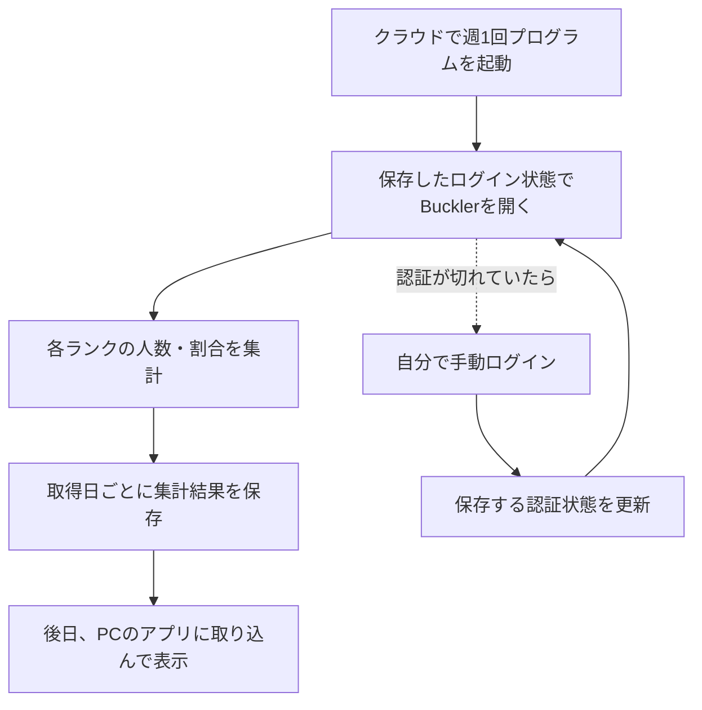

# ランク分布の週次取得フロー

更新日: 2026年10月16日

目標は、自分のPCがオフでも週1回Bucklerのランク分布を取得・保存し、あとでローカルアプリに取り込んで過去の分布を見られるようにすること。アプリは引き続きローカル利用を想定する。

このPCで認証状態を暗号化保存し、ツールとEdgeを終了した後の別起動で再利用できた。さらに2026年10月15日21:55:47〜22:15:49 JSTには、[GitHubのWindows環境で分布全体の取得に成功](https://github.com/gonchiman/sf6/actions/runs/38738293951)した。保存済み認証を使って手動ログインなしに全35境界を新しく確認し、1データセット・36区分を保存した。件数の合計と終了時総数は3,061,539件で、ローカルへの手動取り込みも完了した。取得期間中の概数としての単発取得・保存・手動取り込みは実証できたが、週次実行は未設定で、1週間後の認証再利用も未検証。

## 完成後に目指す流れ

初回は手動でログインし、次回以降に使う認証状態を安全に保存する。通常の取得は自動で行い、認証の期限切れ時には手動で更新する運用を目指す。一時的なGitHub Secretでの受け渡しは単発検証できたため、今後は週次運用での保管期間・認証の有効期間・更新方法を確かめる。

取得時は自分のPCの起動を不要にする。保存された結果をローカルアプリで閲覧するときは、PCとアプリを起動する。

## 現在の進捗

| 工程 | 2026年10月15日時点の状態 |
| --- | --- |
| このPCで認証を保存して再利用 | 確認済み。暗号化保存後にツールとEdgeを終了し、別プロセス・新しいEdgeコンテキストで手動ログインなしに先頭20件を取得できた |
| 1週間後も認証を再利用 | 未検証。今回確認したのは同日内の再利用 |
| クラウドで認証を再利用 | 確認済み。ユーザーの許可を受けた一時Secretの認証状態を使い、GitHubのWindowsとEdgeで手動ログインなしに先頭20件と分布全体を取得できた。全体取得時のSecretは取得ステップ開始直後に削除し、削除確認用のreceiptも削除済み |
| 全ランク分布を実取得 | クラウドで確認済み。保存済み35ヒントを候補にだけ使い、全35境界を新しく確認した。230回中229回成功、サーバーエラーから1回の再読で復帰。開始時・最小総数3,061,476件、最大・終了時総数3,061,539件。ローカル環境での全体取得は未完了 |
| 日付付きデータの保存・ローカル取り込みと表示 | 確認済み。クラウドのArtifactをダウンロードし、1データセット・36区分を検証して既存の取り込み処理でローカルの`public/data/rank-distribution/`へ登録した。実画面の帯・★別表示と概数・取得期間・総数範囲、データ検証とビルドも確認済み。クラウドからローカルへの自動同期は未設定 |
| 週1回の自動実行 | 未設定。実行環境と取得方法を検証してから組み込む |

認証再利用の実操作・判定・保存方法は[認証と閲覧の検証記録](auth-probe.md)を参照。
クラウドの実行方法、認証なしのHTTP 403と認証付きの取得成功、Secretの削除確認は[クラウド取得検証](cloud-probe.md)を参照。
ローカルの全体取得コマンド、過去の停止結果、クラウドでの全体取得成功と手動取り込みは[取得とアプリへの取り込み](collection.md)を参照。

## 保存するデータと失敗時の扱い

履歴として保存するのは取得日時、取得条件、ランク別のアカウント件数、出典、検証結果。ユーザーが選択した概数方式では、全35境界の位置・確認時刻・観測総数、取得期間全体の開始・終了・最小最大総数も保存する。割合は終了時総数を分母に表示時に計算し、同一時点の人口や総数差に基づく誤差上限とは扱わない。

今回クラウドで新しく観測した35件の探索位置も、ローカルの固定checkpointへ安全にマージ済み。次回取得の候補として使い、過去の境界を完成値として持ち越さない。

対象は総合・最大LP・全地域・全プラットフォームの固定条件で掲載されたランキングで、集計単位はファイターアカウントとする。`user_status=1`は固定条件として記録し、全ユーザーという意味は未確認として扱う。

認証情報は集計結果と分けて管理する。元のDPAPI保存と専用ブラウザープロファイルはこのPC内に保持する。10月15日のクラウド検証では、ユーザーの許可を受けてStreet Fighterサイト用の認証状態だけを一時Secretへ送信した。全体取得に使った一時Secretは取得ステップ開始直後に削除し、削除確認用のreceiptも削除済み。DPAPIファイル自体や専用プロファイル全体はクラウドへ送っていない。

取得に失敗した週は前回の正常データを保持し、失敗を記録する。未取得や一部だけの取得を、全ランク0件や完全集計として保存しない。取得条件と検証の詳細は[ランク分布の取得仕様](README.md)に従う。

## 週次運用の実装

週次用の認証Secret、毎週木曜22:30 JSTのworkflow、正常集計とcheckpointを引き継ぐデータ専用ブランチ、実行日と7日後の再利用判定を残す処理を準備している。設定の有効化とクラウドでの手動動作確認が終わった段階で、上の進捗を更新する。保管先・停止・認証更新・結果確認の手順は[週次取得の運用](weekly-collection.md)を参照。

7日後の判定には実時間の経過が必要で、日付を人工的に進めたテストや今日の手動実行だけで「1週間後にも使えた」とは扱わない。

## 次に進める作業

1. 認証の有効期間、週次運用での保管方法、期限切れ時の更新方法を確かめる。
2. 失敗時に前回の正常データを保持する方針で、週次実行と日付ごとの結果保存を組み込む。
3. クラウドで保存した結果をローカルアプリへ取り込む運用を整える。今回実証したのはダウンロード後の手動取り込みで、自動同期は未設定。

クラウドで概数として分布全体を取得・保存し、ローカルへ手動で取り込むところまで実証できた。週次運用では、認証の持続と更新、定期実行、保存結果の受け渡しが残る。
