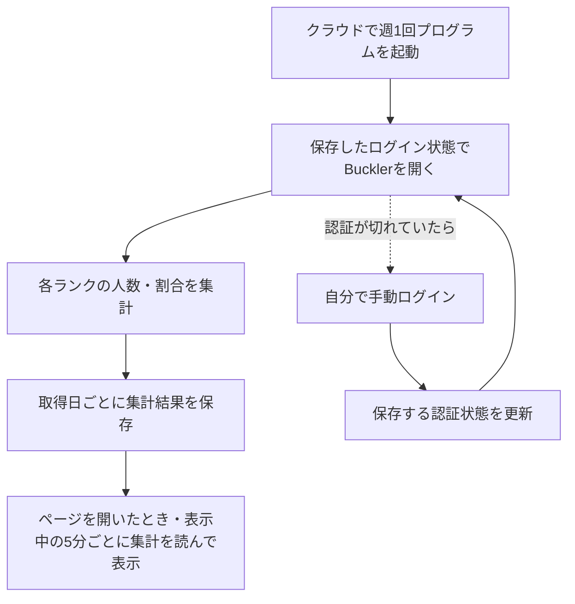

# ランク分布の週次取得フロー

更新日: 2026年10月27日

自分のPCがオフでも週1回Bucklerのランク分布を取得・保存し、LPランク分布ページが保存済みの集計を自動で読み込む。過去の取得日も選択できる。ローカル開発画面とGitHub Pagesで同じ読み込み処理を使う。

このPCで認証状態を暗号化保存し、ツールとEdgeを終了した後の別起動で再利用できた。さらに2026年10月15日21:55:47〜22:15:49 JSTには、[GitHubのWindows環境で分布全体の取得に成功](https://github.com/gonchiman/sf6/actions/runs/38738293951)した。保存済み認証を使って手動ログインなしに全35境界を新しく確認し、1データセット・36区分を保存した。件数の合計と終了時総数は3,061,539件で、ローカルへの手動取り込みも完了した。

2026年10月16日、ユーザーの明示許可を受けて週次workflowを有効化し、週次専用Secretを継続保管する設定を行った。最初の手動確認2回はHTTP 503で停止したが、[その後の再確認](https://github.com/gonchiman/sf6/actions/runs/38861770850)では同じ保存済み認証を使って取得job・保存jobとも成功した。手動ログインなしで全35境界を新しく確認し、新規36区分の集計を保存できた。初回の定期実行予定は2026年10月22日（木）22:30 JSTで、予定時刻の自動起動と7日後の認証再利用はまだ未検証。

## 設定した取得フロー

初回は手動でログインし、次回以降に使う認証状態を安全に保存する。通常の取得は自動で行い、認証の期限切れ時には手動で更新する。単発検証用Secretは削除済みで、現在は別の週次専用Secretを継続保管している。週次設定の有効化後も、認証の有効期間と定期実行の動作は実際の実行結果で確かめる。

取得時は自分のPCの起動を不要にする。保存された結果をローカルアプリで閲覧するときは、PCとアプリを起動する。

## 現在の進捗

| 工程 | 2026年10月27日時点の状態 |
| --- | --- |
| このPCで認証を保存して再利用 | 確認済み。暗号化保存後にツールとEdgeを終了し、別プロセス・新しいEdgeコンテキストで手動ログインなしに先頭20件を取得できた |
| 1週間後も認証を再利用 | 10月23日の定期実行で`reuseAfterSevenDays: confirmed`を確認。初回ログイン状態の確認と全体取得の成功は別に判定する |
| クラウドで認証を再利用 | 10月15日の単発検証に続き、10月16日の週次用Secretでも確認済み。元の保存から約25時間後の新しいEdgeでログイン済み一覧を取得できた。手動ログイン・認証の再保存・Secret更新は行っていない。単発Secretとそのreceiptは削除済みで、週次用Secretは継続保管中 |
| 全ランク分布を実取得 | 10月15日と16日にクラウドで成功。16日の取得期間は15:32:43〜16:09:45 JST、439回中438回成功、再読1回、ブラウザー再起動1回で全35境界を新しく確認。終了時総数・36区分合計3,063,094件、観測最小3,063,020件、最大3,063,094件。取得期間中の概数として保存した |
| 日付付きデータの保存と表示 | クラウドには15日・16日の2データセットを保存。ページは公開履歴を読み、表示中に自動再確認する。通信失敗時は同梱データまたは読み込み済みの正常表示を維持する |
| 週1回の自動実行 | 毎週木曜22:30 JSTの設定は有効。10月23日03:05 JSTに定期起動したが、600回の読込上限・28境界確認で停止し、新しい分布は未保存。失敗記録と過去の正常集計は保存された |

認証再利用の実操作・判定・保存方法は[認証と閲覧の検証記録](auth-probe.md)を参照。
クラウドの実行方法、認証なしのHTTP 403と認証付きの取得成功、Secretの削除確認は[クラウド取得検証](cloud-probe.md)を参照。
ローカルの全体取得コマンド、過去の停止結果、クラウドでの全体取得成功と手動取り込みは[取得とアプリへの取り込み](collection.md)を参照。

## 保存するデータと失敗時の扱い

履歴として保存するのは取得日時、取得条件、ランク別のアカウント件数、出典、検証結果。ユーザーが選択した概数方式では、全35境界の位置・確認時刻・観測総数、取得期間全体の開始・終了・最小最大総数も保存する。割合は終了時総数を分母に表示時に計算し、同一時点の人口や総数差に基づく誤差上限とは扱わない。

今回クラウドで新しく観測した35件の探索位置も、ローカルの固定checkpointへ安全にマージ済み。次回取得の候補として使い、過去の境界を完成値として持ち越さない。

対象は総合・最大LP・全地域・全プラットフォームの固定条件で掲載されたランキングで、集計単位はファイターアカウントとする。`user_status=1`は固定条件として記録し、全ユーザーという意味は未確認として扱う。

認証情報は集計結果と分けて管理する。元のDPAPI保存と専用ブラウザープロファイルはこのPC内に保持する。10月15日のクラウド単発検証で使った`BUCKLER_CLOUD_PROBE_SESSION`とそのreceiptは削除済み。10月16日は別途の明示許可を受けて、Street Fighterサイト用の認証状態を`BUCKLER_WEEKLY_SESSION`へ送信した。週次用Secretは運用停止または認証更新まで継続保管する。DPAPIファイル自体や専用プロファイル全体はクラウドへ送っていない。

保存するのは集計・探索候補・安全なrun記録だけで、専用ブランチ`codex/rank-distribution-history`に保存する。LPランク分布ページは同ブランチの集計JSONを直接読み、表示中に再確認する。この自動反映の実装を一度mainへ反映・公開した後は、集計更新のたびにmainへデータを取り込む必要はない。詳細は[ページへの自動反映](README.md#ページへの自動反映)を参照。

取得に失敗した週は前回の正常データを保持し、失敗を記録する。未取得や一部だけの取得を、全ランク0件や完全集計として保存しない。取得条件と検証の詳細は[ランク分布の取得仕様](README.md)に従う。

## 週次運用の実装

週次用の認証Secret、毎週木曜22:30 JSTのworkflow、正常集計とcheckpointを引き継ぐデータ専用ブランチ、実行日と7日後の再利用判定を残す処理を設定済み。[週次workflow](https://github.com/gonchiman/sf6/actions/workflows/rank-distribution-weekly.yml)は有効。同じ処理の手動起動で全体取得・保存が成功することと、HTTP 503時に過去の正常データと失敗記録を保持することの両方を実環境で確認できた。保管先・停止・認証更新・結果確認の手順は[週次取得の運用](weekly-collection.md)を参照。

7日後の判定には実時間の経過が必要で、日付を人工的に進めたテストや今日の手動実行だけで「1週間後にも使えた」とは扱わない。

## 次に進める作業

1. 定期取得が全35境界を完了できるか継続して確認する。10月23日の停止は取得プログラムの上限によるもので、認証再利用の確認とは分けて扱う。
2. 自動反映のコードをmainへ反映・公開する。同梱データも新しくしたい場合だけ、従来の手動importを使う。
3. 認証の更新が必要になった場合は手動ログイン・再保存・週次Secretの削除と再送信を行い、運用停止時にはworkflowを無効化して週次Secretを削除する。

10月23日の[定期実行](https://github.com/gonchiman/sf6/actions/runs/39828328376)では自動起動と7日後の認証再利用を確認したが、分布全体の取得は未完了。10月27日時点で正常な最新取得は10月16日分であり、一覧の生成日時を最新取得日として扱わない。
