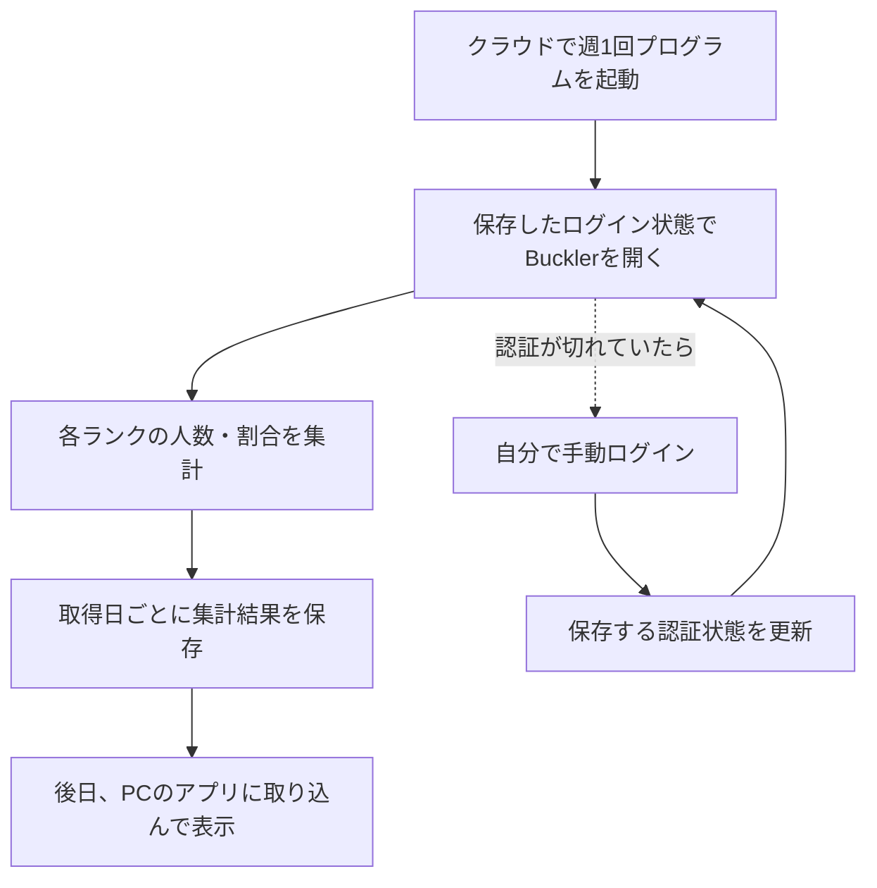

# ランク分布の週次取得フロー

更新日: 2026年10月16日

目標は、自分のPCがオフでも週1回Bucklerのランク分布を取得・保存し、あとでローカルアプリに取り込んで過去の分布を見られるようにすること。アプリは引き続きローカル利用を想定する。

このPCで認証状態を暗号化保存し、ツールとEdgeを終了した後の別起動で再利用できた。さらに2026年10月15日21:55:47〜22:15:49 JSTには、[GitHubのWindows環境で分布全体の取得に成功](https://github.com/gonchiman/sf6/actions/runs/38738293951)した。保存済み認証を使って手動ログインなしに全35境界を新しく確認し、1データセット・36区分を保存した。件数の合計と終了時総数は3,061,539件で、ローカルへの手動取り込みも完了した。

2026年10月16日、ユーザーの明示許可を受けて週次workflowを有効化し、週次専用Secretを継続保管する設定を行った。[週次処理の初回手動確認](https://github.com/gonchiman/sf6/actions/runs/38853314940)と[1回の再試行](https://github.com/gonchiman/sf6/actions/runs/38853621670)は、ともにBucklerのHTTP 503で取得前に停止した。両方の保存jobは成功し、前回の正常集計1件・36区分とcheckpoint35件を保持して失敗記録を追加できた。現在の認証での取得は確認できておらず、サーバー応答の回復後に再テストが必要。初回の定期実行予定は2026年10月22日（木）22:30 JSTで、定期実行の成功と7日後の認証再利用は未検証。

## 設定した取得フロー

初回は手動でログインし、次回以降に使う認証状態を安全に保存する。通常の取得は自動で行い、認証の期限切れ時には手動で更新する。単発検証用Secretは削除済みで、現在は別の週次専用Secretを継続保管している。週次設定の有効化後も、認証の有効期間と定期実行の動作は実際の実行結果で確かめる。

取得時は自分のPCの起動を不要にする。保存された結果をローカルアプリで閲覧するときは、PCとアプリを起動する。

## 現在の進捗

| 工程 | 2026年10月16日時点の状態 |
| --- | --- |
| このPCで認証を保存して再利用 | 確認済み。暗号化保存後にツールとEdgeを終了し、別プロセス・新しいEdgeコンテキストで手動ログインなしに先頭20件を取得できた |
| 1週間後も認証を再利用 | 未検証。元の保存日時は2026年10月15日14:28:41 JST。初回の定期実行予定は10月22日22:30 JSTで、保存から168時間以上経過した実行の結果を確認する |
| クラウドで認証を再利用 | 10月15日の単発検証で確認済み。単発Secretとそのreceiptは削除済み。週次専用Secretは別に送信済みで、10月16日の手動確認2回は先頭取得時のHTTP 503で停止。現在の認証の有効性は未確認で、期限切れとは断定しない |
| 全ランク分布を実取得 | クラウドで確認済み。保存済み35ヒントを候補にだけ使い、全35境界を新しく確認した。230回中229回成功、サーバーエラーから1回の再読で復帰。開始時・最小総数3,061,476件、最大・終了時総数3,061,539件。ローカル環境での全体取得は未完了 |
| 日付付きデータの保存・ローカル取り込みと表示 | 確認済み。クラウドのArtifactをダウンロードし、1データセット・36区分を検証して既存の取り込み処理でローカルの`public/data/rank-distribution/`へ登録した。実画面の帯・★別表示と概数・取得期間・総数範囲、データ検証とビルドも確認済み。クラウドからローカルへの自動同期は未設定 |
| 週1回の自動実行 | 設定を有効化済み。毎週木曜22:30 JST、初回は10月22日予定。手動確認2回の取得はHTTP 503で停止したが、失敗記録の保存と正常履歴の保持は確認できた。定期実行の成功は未検証 |

認証再利用の実操作・判定・保存方法は[認証と閲覧の検証記録](auth-probe.md)を参照。
クラウドの実行方法、認証なしのHTTP 403と認証付きの取得成功、Secretの削除確認は[クラウド取得検証](cloud-probe.md)を参照。
ローカルの全体取得コマンド、過去の停止結果、クラウドでの全体取得成功と手動取り込みは[取得とアプリへの取り込み](collection.md)を参照。

## 保存するデータと失敗時の扱い

履歴として保存するのは取得日時、取得条件、ランク別のアカウント件数、出典、検証結果。ユーザーが選択した概数方式では、全35境界の位置・確認時刻・観測総数、取得期間全体の開始・終了・最小最大総数も保存する。割合は終了時総数を分母に表示時に計算し、同一時点の人口や総数差に基づく誤差上限とは扱わない。

今回クラウドで新しく観測した35件の探索位置も、ローカルの固定checkpointへ安全にマージ済み。次回取得の候補として使い、過去の境界を完成値として持ち越さない。

対象は総合・最大LP・全地域・全プラットフォームの固定条件で掲載されたランキングで、集計単位はファイターアカウントとする。`user_status=1`は固定条件として記録し、全ユーザーという意味は未確認として扱う。

認証情報は集計結果と分けて管理する。元のDPAPI保存と専用ブラウザープロファイルはこのPC内に保持する。10月15日のクラウド単発検証で使った`BUCKLER_CLOUD_PROBE_SESSION`とそのreceiptは削除済み。10月16日は別途の明示許可を受けて、Street Fighterサイト用の認証状態を`BUCKLER_WEEKLY_SESSION`へ送信した。週次用Secretは運用停止または認証更新まで継続保管する。DPAPIファイル自体や専用プロファイル全体はクラウドへ送っていない。

公開するのは集計・探索候補・安全なrun記録だけで、専用ブランチ`codex/rank-distribution-history`に保存する。アプリはローカル利用のままで、必要なときに履歴を手動で取り込む。データ保存からアプリの自動公開や自動同期は行わない。

取得に失敗した週は前回の正常データを保持し、失敗を記録する。未取得や一部だけの取得を、全ランク0件や完全集計として保存しない。取得条件と検証の詳細は[ランク分布の取得仕様](README.md)に従う。

## 週次運用の実装

週次用の認証Secret、毎週木曜22:30 JSTのworkflow、正常集計とcheckpointを引き継ぐデータ専用ブランチ、実行日と7日後の再利用判定を残す処理を設定済み。[週次workflow](https://github.com/gonchiman/sf6/actions/workflows/rank-distribution-weekly.yml)は有効で、HTTP 503時に取得を中止して過去の正常データと失敗記録を保存する動作を実環境でも確認できた。保管先・停止・認証更新・結果確認の手順は[週次取得の運用](weekly-collection.md)を参照。

7日後の判定には実時間の経過が必要で、日付を人工的に進めたテストや今日の手動実行だけで「1週間後にも使えた」とは扱わない。

## 次に進める作業

1. Bucklerの応答回復後に手動実行し、現在の認証を使った取得成功を確認する。10月16日の2回はHTTP 503で止まっており、認証確認や新規の集計追加には進んでいない。
2. 10月22日以降、実際の定期実行と保存から168時間以上経過した認証の再利用を確認する。失敗時は前回の正常データを保持できたかも確認する。
3. 必要な履歴をローカルアプリへ手動で取り込む。認証の更新が必要になった場合は手動ログイン・再保存・週次Secretの削除と再送信を行い、運用停止時にはworkflowを無効化して週次Secretを削除する。

10月15日はクラウドで分布全体を取得してローカルへ手動で取り込めた。10月16日は週次設定の有効化と、取得元のHTTP 503時に正常履歴を保持する動作を確認できた。応答回復後の実取得、初回の定期実行、7日後の認証再利用の確認が残る。
